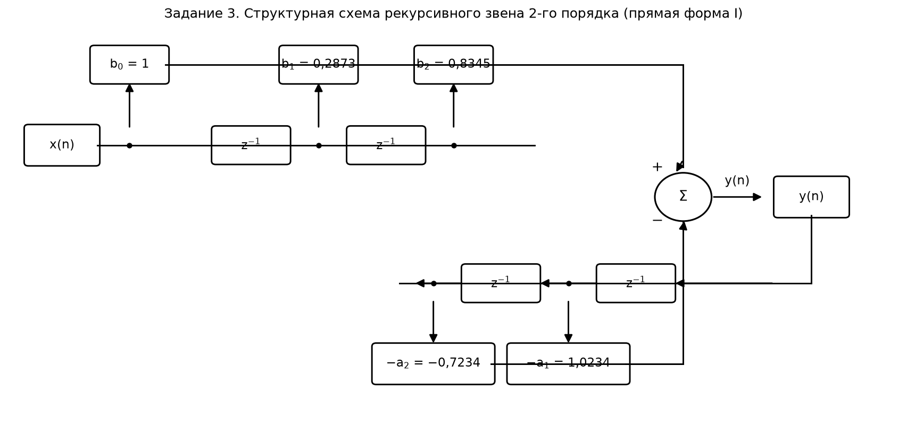
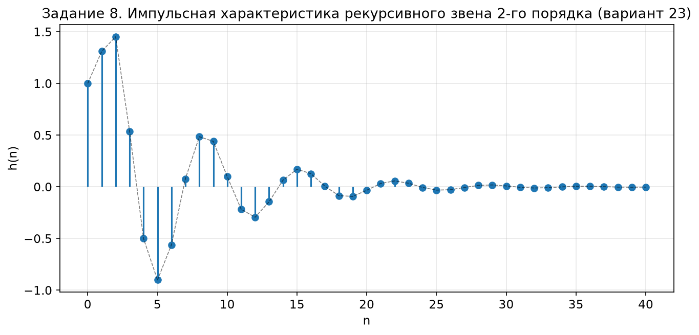
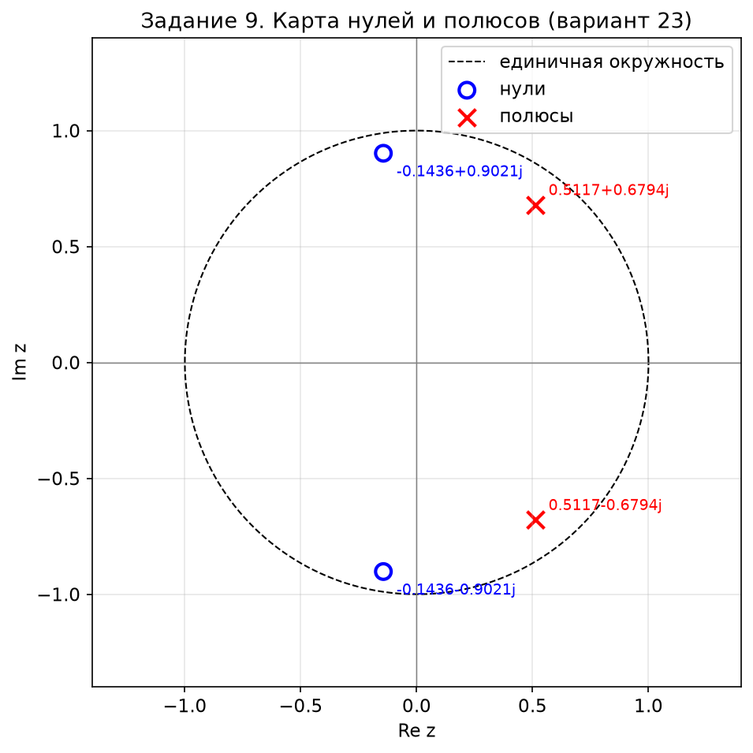
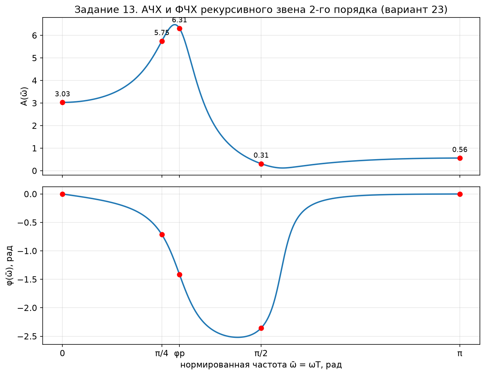

# Контрольная работа №1 по ЦОС
## Рекурсивное звено 2-го порядка — **вариант 23**

№ группы: ____________  ФИО: ____________________

**Исходные данные** (таблица «Варианты коэффициентов передаточной функции», вариант 23):

| Вариант | b₀ | b₁ | b₂ | a₁ | a₂ |
|:---:|:---:|:---:|:---:|:---:|:---:|
| **23** | 1 | 0,2873 | 0,8345 | −1,0234 | 0,7234 |

Общий вид передаточной функции линейной дискретной системы (ЛДС):

$$H(z)=\frac{X(z)}{Y(z)}=\frac{b_0+b_1z^{-1}+b_2z^{-2}}{1+a_1z^{-1}+a_2z^{-2}}$$

где b₀, b₁, b₂ — коэффициенты числителя (связаны с воздействием x(n)); a₁, a₂ — коэффициенты знаменателя (связаны с реакцией y(n)); z⁻¹ — оператор задержки на один период дискретизации.

---

## Задание 1. Общий вид передаточной функции рекурсивного звена 2-го порядка

Подставляем коэффициенты варианта 23 в общую формулу:

$$H(z)=\frac{1+0{,}2873\,z^{-1}+0{,}8345\,z^{-2}}{1-1{,}0234\,z^{-1}+0{,}7234\,z^{-2}}$$

**Анализ полученной передаточной функции:**

- **Порядок системы:** наибольшая степень z в знаменателе равна 2 → система **2-го порядка**.
- **Тип звена:** знаменатель не равен 1 → звено **рекурсивное** (есть обратные связи); числитель не равен 1 (b₁≠0, b₂≠0) → звено **небазовое**.
- **Устойчивость:** полюсы ПФ (корни знаменателя) найдены в задании 9: r = 0,8505 < 1, т.е. все полюсы лежат внутри единичной окружности → система **устойчива**.

## Задание 2. Разностное уравнение

Из H(z) = Y(z)/X(z) следует Y(z)·(1 + a₁z⁻¹ + a₂z⁻²) = X(z)·(b₀ + b₁z⁻¹ + b₂z⁻²). Переходя во временную область:

$$y(n)=b_0x(n)+b_1x(n-1)+b_2x(n-2)-a_1y(n-1)-a_2y(n-2)$$

Подстановка коэффициентов варианта 23 (с учётом знака a₁ = −1,0234):

$$\boxed{y(n)=x(n)+0{,}2873\,x(n-1)+0{,}8345\,x(n-2)+1{,}0234\,y(n-1)-0{,}7234\,y(n-2)}$$

## Задание 3. Структурная схема

Прямая форма I рекурсивного звена 2-го порядка: прямая ветвь (x(n) → z⁻¹ → z⁻¹ с отводах через b₀, b₁, b₂) и обратная ветвь (y(n) → z⁻¹ → z⁻¹ с отводах через −a₁, −a₂) суммируются в сумматоре Σ:



## Задание 4. Импульсная характеристика

**Нахождение полюсов.** Полюсы — корни знаменателя: умножим числитель и знаменатель на z², тогда знаменатель: z² + a₁z + a₂ = 0, т.е.

$$z^2-1{,}0234\,z+0{,}7234=0,\qquad D=a_1^2-4a_2=1{,}0473-2{,}8936=-1{,}8463<0$$

— пара комплексно-сопряжённых полюсов:

$$p_{1,2}=\frac{-a_1}{2}\pm j\frac{\sqrt{4a_2-a_1^2}}{2}=0{,}5117\pm j\,0{,}6794$$

**Радиус полюсов:** r = |p| = √(a₂) = √0,7234 = **0,8505**.
**Угол полюсов:** φₚ = arccos(Re p / r) = arccos(0,5117/0,8505) = arccos(0,6015) = **0,9253 рад = 0,2945π**; sin φₚ = **0,7988**.
Полюсы в показательной форме: p₁,₂ = r·e^(±jφₚ) = 0,8505·e^(±j0,9253).

**Формула импульсной характеристики небазового звена 2-го порядка** (при нулевых начальных условиях):

$$h(n)=\begin{cases}
b_0r^{n}\dfrac{\sin[(n+1)\varphi_p]}{\sin\varphi_p}, & n=0\\[2mm]
b_0r^{n}\dfrac{\sin[(n+1)\varphi_p]}{\sin\varphi_p}+b_1r^{n-1}\dfrac{\sin(n\varphi_p)}{\sin\varphi_p}, & n=1\\[2mm]
b_0r^{n}\dfrac{\sin[(n+1)\varphi_p]}{\sin\varphi_p}+b_1r^{n-1}\dfrac{\sin(n\varphi_p)}{\sin\varphi_p}+b_2r^{n-2}\dfrac{\sin[(n-1)\varphi_p]}{\sin\varphi_p}, & n\ge 2
\end{cases}$$

Подстановка значений (b₀=1, b₁=0,2873, b₂=0,8345, r=0,8505, φₚ=0,9253 рад, sin φₚ=0,7988):

$$h(n)=0{,}8505^{n}\frac{\sin[(n+1)\cdot0{,}9253]}{0{,}7988}+0{,}2873\cdot0{,}8505^{n-1}\frac{\sin(n\cdot0{,}9253)}{0{,}7988}+0{,}8345\cdot0{,}8505^{n-2}\frac{\sin[(n-1)\cdot0{,}9253]}{0{,}7988}$$

## Задание 5. Расчёт 5 отсчётов ИХ по формуле

| n | Вычисление по формуле | h(n) |
|:---:|:---|:---:|
| 0 | h(0) = 1·0,8505⁰·sin(0,9253)/0,7988 = 1·1·1 | **1,0000** |
| 1 | h(1) = 0,8505·sin(2·0,9253)/0,7988 + 0,2873 = 0,8505·0,9611/0,7988 + 0,2873 = 1,0234 + 0,2873 | **1,3107** |
| 2 | h(2) = 0,8505²·sin(3·0,9253)/0,7988 + 0,2873·0,8505·sin(2·0,9253)/0,7988 + 0,8345 = 0,3239 + 0,2940 + 0,8345 | **1,4525** |
| 3 | h(3) = 0,8505³·sin(4·0,9253)/0,7988 + 0,2873·0,8505²·sin(3·0,9253)/0,7988 + 0,8345·0,8505·sin(2·0,9253)/0,7988 = −0,4088 + 0,0931 + 0,8540 | **0,5383** |
| 4 | h(4) = 0,8505⁴·sin(5·0,9253)/0,7988 + 0,2873·0,8505³·sin(4·0,9253)/0,7988 + 0,8345·0,8505²·sin(3·0,9253)/0,7988 = −0,6527 − 0,1174 + 0,2703 | **−0,4998** |

**Ответ:** h(0)=1,0000; h(1)=1,3107; h(2)=1,4525; h(3)=0,5383; h(4)=−0,4998.

## Задание 6. Расчёт ИХ по разностному уравнению

При x(n) = δ(n) (единичный импульс) и нулевых начальных условиях h(−1)=h(−2)=0:

$$h(n)=b_0\delta(n)+b_1\delta(n-1)+b_2\delta(n-2)-a_1h(n-1)-a_2h(n-2)$$

- n = 0: h(0) = b₀·1 = 1 → **1,0000**
- n = 1: h(1) = b₁ − a₁h(0) = 0,2873 + 1,0234·1 = **1,3107**
- n = 2: h(2) = b₂ − a₁h(1) − a₂h(0) = 0,8345 + 1,0234·1,3107 − 0,7234·1 = **1,4525**
- n = 3: h(3) = −a₁h(2) − a₂h(1) = 1,0234·1,4525 − 0,7234·1,3107 = **0,5383**
- n = 4: h(4) = −a₁h(3) − a₂h(2) = 1,0234·0,5383 − 0,7234·1,4525 = **−0,4998**

## Задание 7. Сравнение результатов вычислений импульсной характеристики

| n | h(n) по формуле (задание 5) | h(n) по РУ (задание 6) | Разность |
|:---:|:---:|:---:|:---:|
| 0 | 1,0000 | 1,0000 | 0,0000 |
| 1 | 1,3107 | 1,3107 | 0,0000 |
| 2 | 1,4525 | 1,4525 | 0,0000 |
| 3 | 0,5383 | 0,5383 | 0,0000 |
| 4 | −0,4998 | −0,4998 | 0,0000 |

**Вывод:** результаты совпадают (при полной точности расчёта разность равна 0, машинный эпсилон ~10⁻¹⁶). При ручном счёте с округлением r = 0,8505 и φₚ = 0,9253 рад до 4 знаков формула даёт 1,0000 / 1,3106 / 1,4523 / 0,5381 / −0,4998, и разность с РУ не превышает 2·10⁻⁴ — различия объясняются ошибкой округления промежуточных значений.

## Задание 8. Построение графика импульсной характеристики



ИХ — затухающая колебательная последовательность (r = 0,8505 < 1), период колебаний T ≈ 2π/φₚ ≈ 6,79 отсчёта; при n → ∞ h(n) → 0, что подтверждает устойчивость звена.

## Задание 9. Построение карты нулей и полюсов

**Нули** — корни числителя: b₀z² + b₁z + b₂ = 0 → z² + 0,2873z + 0,8345 = 0:

$$z_{1,2}=\frac{-0{,}2873\pm j\sqrt{4\cdot0{,}8345-0{,}2873^2}}{2}=-0{,}1437\pm j\,0{,}9021,\qquad |z|=\sqrt{0{,}8345}=0{,}9135$$

**Полюсы** (из задания 4): p₁,₂ = 0,5117 ± j0,6794, r = 0,8505.



Оба полюса лежат **внутри единичной окружности** (r = 0,8505 < 1) → рекурсивное звено **устойчиво**.

## Задание 10. Формулы для расчёта АЧХ и ФЧХ в произвольной точке

Частотная характеристика получается подстановкой z = e^(jωT) = e^(jω̄), где ω̄ = ωT — нормированная частота:

$$H(e^{j\bar\omega})=\frac{b_0+b_1e^{-j\bar\omega}+b_2e^{-j2\bar\omega}}{1+a_1e^{-j\bar\omega}+a_2e^{-j2\bar\omega}}$$

По формуле Эйлера e^(−jkω̄) = cos(kω̄) − j·sin(kω̄) выделяем вещественные и мнимые части:

- числитель: **Reч** = b₀ + b₁cos ω̄ + b₂cos 2ω̄,  **Imч** = −b₁sin ω̄ − b₂sin 2ω̄
- знаменатель: **Reз** = 1 + a₁cos ω̄ + a₂cos 2ω̄,  **Imз** = −a₁sin ω̄ − a₂sin 2ω̄

**АЧХ** — модуль частотной характеристики:

$$A(\bar\omega)=|H(e^{j\bar\omega})|=\frac{\sqrt{Re_ч^2+Im_ч^2}}{\sqrt{Re_з^2+Im_з^2}}$$

**ФЧХ** — аргумент частотной характеристики (с учётом квадрантов, т.е. через atan2):

$$\varphi(\bar\omega)=\arg H(e^{j\bar\omega})=\arctg\frac{Im_ч}{Re_ч}-\arctg\frac{Im_з}{Re_з}$$

Подстановка коэффициентов варианта 23:

$$A(\bar\omega)=\frac{\sqrt{[1+0{,}2873\cos\bar\omega+0{,}8345\cos2\bar\omega]^2+[-0{,}2873\sin\bar\omega-0{,}8345\sin2\bar\omega]^2}}{\sqrt{[1-1{,}0234\cos\bar\omega+0{,}7234\cos2\bar\omega]^2+[1{,}0234\sin\bar\omega-0{,}7234\sin2\bar\omega]^2}}$$

$$\varphi(\bar\omega)=\arctg\frac{-0{,}2873\sin\bar\omega-0{,}8345\sin2\bar\omega}{1+0{,}2873\cos\bar\omega+0{,}8345\cos2\bar\omega}-\arctg\frac{1{,}0234\sin\bar\omega-0{,}7234\sin2\bar\omega}{1-1{,}0234\cos\bar\omega+0{,}7234\cos2\bar\omega}$$

## Задание 11. Качественный анализ АЧХ и ФЧХ по карте нулей и полюсов

- Полюсы p₁,₂ = 0,5117 ± j0,6794 (r = 0,8505 < 1) лежат внутри единичной окружности под углом φₚ = 0,9253 рад ≈ 0,2945π и относительно близко к ней → **резонансный подъём АЧХ вблизи ω̄ ≈ φₚ** (средние частоты); звено устойчивое.
- Нули z₁,₂ = −0,1437 ± j0,9021 (|z| = 0,9135) расположены во 2-й/3-й четвертях под углами ≈ ±1,729 рад (≈ ±0,55π) → **провал АЧХ на высоких частотах**.
- На границах диапазона: A(0) = (1+b₁+b₂)/(1+a₁+a₂) = 2,1218/0,7000 = **3,0311**, φ(0) = 0 (низкие частоты усиливаются); A(π) = (1−b₁+b₂)/(1−a₁+a₂) = 1,5472/2,7468 = **0,5633**, φ(π) = 0 (высокие частоты ослабляются).
- **Вывод:** звено имеет **полосовой характер** с максимумом АЧХ на средних частотах вблизи ω̄ ≈ 0,9 рад; ФЧХ на границах [0, π] равна нулю (все коэффициенты вещественные), внутри полосы ФЧХ отрицательна (фазовый сдвиг сигнала).

## Задание 12. Экспресс-анализ АЧХ и ФЧХ

Расчёт в пяти характерных точках нормированной частоты: ω̄ = 0 (НЧ), ω̄ = π/4 (доп. точка), ω̄ = π/2 (СЧ), ω̄ = φₚ = 0,9253 (частота полюса, ожидаемый максимум АЧХ), ω̄ = π (ВЧ):

| Нормированная частота ω̄ | ω̄, рад | АЧХ A(ω̄) | ФЧХ φ(ω̄), рад |
|:---:|:---:|:---:|:---:|
| ω̄ = 0 | 0 | 3,0311 | 0 |
| ω̄ = π/4 | 0,7854 | 5,7493 | −0,7126 |
| ω̄ = π/2 | 1,5708 | 0,3128 | −2,3550 |
| ω̄ = φₚ | 0,9253 | 6,3124 | −1,4153 |
| ω̄ = π | 3,1416 | 0,5633 | 0 |

**Вывод:** результаты экспресс-анализа подтверждают качественный анализ — система **полосового типа**: максимум АЧХ наблюдается вблизи частоты полюса (A(φₚ) = 6,3124; точный максимум A = 6,4774 при ω̄ = 0,8875), на ω̄ = 0 усиление 3,03, на ω̄ = π ослабление до 0,56.

## Задание 13. Построение графиков АЧХ и ФЧХ



Красными точками отмечены пять точек экспресс-анализа (задание 12). АЧХ имеет резонансный максимум вблизи ω̄ ≈ 0,9 рад и спадает к ω̄ = π; ФЧХ равна 0 на границах и отрицательна внутри полосы.

---

## Приложение. Программа расчёта (Python)

Скрипт выполняет все вычисления заданий 1–13 и строит рисунки `figures/fig1..fig4.png`
(зависимости: `numpy`, `matplotlib`). Сохраните листинг рядом с этим файлом, например
как `kr1.py`, и запустите: `python3 kr1.py`.

```python
#!/usr/bin/env python3
# -*- coding: utf-8 -*-
"""
Контрольная работа №1 по ЦОС, вариант 23.
Рекурсивное звено 2-го порядка: ПФ, разностное уравнение, структурная схема,
импульсная характеристика, карта нулей и полюсов, АЧХ и ФЧХ.

Исходные данные (вариант 23):
    b0 = 1, b1 = 0.2873, b2 = 0.8345, a1 = -1.0234, a2 = 0.7234

Запуск:  python3 kr1_final.py
Результат:  печать расчёта в консоль + рисунки figures/fig*.png
"""
import numpy as np
import matplotlib
matplotlib.use("Agg")
import matplotlib.pyplot as plt
from matplotlib.patches import FancyBboxPatch, Circle, FancyArrowPatch
from pathlib import Path

OUT = Path(__file__).resolve().parent / "figures"
OUT.mkdir(parents=True, exist_ok=True)
plt.rcParams.update({"font.size": 11, "figure.dpi": 150})

# ================= Исходные данные, вариант 23 =================
b0, b1, b2 = 1.0, 0.2873, 0.8345
a1, a2 = -1.0234, 0.7234
b = np.array([b0, b1, b2])
a = np.array([1.0, a1, a2])

def f(x, d=4):
    return f"{x:.{d}f}"

# ================= Задание 4/9: полюсы и нули =================
poles = np.roots(a)          # знаменатель: z^2 + a1*z + a2 = 0
zeros = np.roots(b)          # числитель:  b0*z^2 + b1*z + b2 = 0
p = poles[0]
r = float(np.abs(p))         # радиус полюсов r = sqrt(a2)
phi = float(np.angle(p))     # угол полюса phi_p, рад
sin_phi = float(np.sin(phi))

print("Полюсы: p1,2 =", f(p.real, 4), "± j", f(p.imag, 4),
      "| r =", f(r, 4), "| phi_p =", f(phi, 4), "рад =", f(phi / np.pi, 4), "pi | sin(phi_p) =", f(sin_phi, 4))
print("Нули:   z1,2 =", f(zeros[0].real, 4), "± j", f(zeros[0].imag, 4),
      "| |z| =", f(abs(zeros[0]), 4))

# ================= Задание 4: ИХ по аналитической формуле =================
def h_formula(n):
    """ИХ небазового рекурсивного звена 2-го порядка (нулевые начальные условия)."""
    v = b0 * r**n * np.sin((n + 1) * phi) / sin_phi
    if n >= 1:
        v += b1 * r**(n - 1) * np.sin(n * phi) / sin_phi
    if n >= 2:
        v += b2 * r**(n - 2) * np.sin((n - 1) * phi) / sin_phi
    return v

# ================= Задание 6: ИХ по разностному уравнению =================
def h_de(nmax):
    """y(n) = b0 x(n) + b1 x(n-1) + b2 x(n-2) - a1 y(n-1) - a2 y(n-2), x(n)=delta(n)."""
    h = np.zeros(nmax + 1)
    for n in range(nmax + 1):
        y = b0 * (1.0 if n == 0 else 0.0)
        if n >= 1: y += b1 * (1.0 if n == 1 else 0.0)
        if n >= 2: y += b2 * (1.0 if n == 2 else 0.0)
        if n >= 1: y -= a1 * h[n - 1]
        if n >= 2: y -= a2 * h[n - 2]
        h[n] = y
    return h

NMAX = 40
h_f = np.array([h_formula(n) for n in range(NMAX + 1)])
h_r = h_de(NMAX)

print("\nЗадания 5/6/7 — 5 отсчётов ИХ:")
print(f"{'n':>2} {'h(n) по формуле':>16} {'h(n) по РУ':>12} {'разность':>10}")
for n in range(5):
    print(f"{n:>2} {h_f[n]:>16.6f} {h_r[n]:>12.6f} {h_f[n]-h_r[n]:>10.1e}")

# ================= Задания 10/12/13: АЧХ и ФЧХ =================
def Hjw(w):
    """Частотная характеристика H(e^{jw}) при z = e^{jw}, w = omega*T."""
    z = np.exp(1j * w)
    return (b0 + b1 / z + b2 / z**2) / (1 + a1 / z + a2 / z**2)

w = np.linspace(0, np.pi, 2001)
H = Hjw(w)
A = np.abs(H)
PH = np.angle(H)

pts = [("0", 0.0), ("pi/4", np.pi / 4), ("pi/2", np.pi / 2), ("phi_p", phi), ("pi", np.pi)]
print("\nЗадание 12 — экспресс-анализ АЧХ и ФЧХ в пяти точках:")
print(f"{'w̄':>7} {'w̄, рад':>9} {'A(w̄)':>9} {'φ(w̄), рад':>11}")
for name, wv in pts:
    Hv = Hjw(wv)
    print(f"{name:>7} {wv:>9.4f} {abs(Hv):>9.4f} {np.angle(Hv):>11.4f}")
print("A(0)  = (1+b1+b2)/(1+a1+a2) =", f((1 + b1 + b2) / (1 + a1 + a2), 4))
print("A(pi) = (1-b1+b2)/(1-a1+a2) =", f((1 - b1 + b2) / (1 - a1 + a2), 4))
print("max A(ω̄) =", f(A.max(), 4), "при ω̄ =", f(w[np.argmax(A)], 4), "(полюсный угол φ_p =", f(phi, 4), ")")

# ================= Рисунок 1: структурная схема (задание 3) =================
fig, ax = plt.subplots(figsize=(11.5, 5.6))
ax.set_xlim(-0.6, 12.6); ax.set_ylim(-0.9, 6.1); ax.axis("off")

def box(x, y, text, w=1.05, h=0.55):
    ax.add_patch(FancyBboxPatch((x - w/2, y - h/2), w, h, boxstyle="round,pad=0.06",
                                fc="white", ec="black", lw=1.4))
    ax.text(x, y, text, ha="center", va="center", fontsize=11)

def arr(x1, y1, x2, y2):
    ax.add_patch(FancyArrowPatch((x1, y1), (x2, y2), arrowstyle="-|>",
                                 mutation_scale=15, lw=1.4, color="black"))

def line(x1, y1, x2, y2):
    ax.plot([x1, x2], [y1, y2], color="black", lw=1.4)

# прямая ветвь (входная), y = 4
box(0.2, 4, "x(n)", 1.0, 0.6)
line(0.72, 4, 7.2, 4)
box(3.0, 4, "z$^{-1}$"); box(5.0, 4, "z$^{-1}$")
for nx in (1.2, 4.0, 6.0):
    ax.plot(nx, 4, "ko", ms=4)
box(1.2, 5.4, "b$_0$ = 1")
box(4.0, 5.4, "b$_1$ = 0,2873")
box(6.0, 5.4, "b$_2$ = 0,8345")
for nx in (1.2, 4.0, 6.0):
    arr(nx, 4.28, nx, 5.12)               # узел -> умножитель
    line(nx + 0.53, 5.4, 9.4, 5.4)        # вправо
line(9.4, 5.4, 9.4, 3.62)
arr(9.4, 3.75, 9.28, 3.5)                 # в сумматор

# сумматор и выход
ax.add_patch(Circle((9.4, 3.1), 0.42, fc="white", ec="black", lw=1.5))
ax.text(9.4, 3.1, "Σ", ha="center", va="center", fontsize=13)
ax.text(9.02, 3.55, "+", fontsize=13, ha="center")
ax.text(9.02, 2.62, "−", fontsize=13, ha="center")
arr(9.82, 3.1, 10.6, 3.1)
ax.text(10.2, 3.32, "y(n)", ha="center", fontsize=11)
box(11.3, 3.1, "y(n)", 1.0, 0.6)

# обратная ветвь, y = 1.6 (сигнал справа налево)
line(11.3, 2.78, 11.3, 1.6)
line(11.3, 1.6, 5.2, 1.6)
box(8.7, 1.6, "z$^{-1}$"); box(6.7, 1.6, "z$^{-1}$")
arr(10.75, 1.6, 9.25, 1.6)
arr(8.15, 1.6, 7.25, 1.6)
arr(6.15, 1.6, 5.4, 1.6)
for nx in (7.7, 5.7):
    ax.plot(nx, 1.6, "ko", ms=4)
box(7.7, 0.2, "−a$_1$ = 1,0234", 1.7, 0.6)
box(5.7, 0.2, "−a$_2$ = −0,7234", 1.7, 0.6)
for nx in (7.7, 5.7):
    arr(nx, 1.32, nx, 0.52)
    line(nx + 0.85, 0.2, 9.4, 0.2)
line(9.4, 0.2, 9.4, 2.68)
arr(9.4, 2.55, 9.42, 2.72)

ax.set_title("Задание 3. Структурная схема рекурсивного звена 2-го порядка (прямая форма I)", fontsize=12)
fig.tight_layout()
fig.savefig(OUT / "fig1_structure.png", bbox_inches="tight")
plt.close(fig)

# ================= Рисунок 2: импульсная характеристика (задание 8) =================
fig, ax = plt.subplots(figsize=(9, 4.5))
n = np.arange(NMAX + 1)
ax.stem(n, h_f, basefmt=" ")
ax.plot(n, h_f, "k--", lw=0.8, alpha=0.5)
ax.set_xlabel("n"); ax.set_ylabel("h(n)")
ax.set_title("Задание 8. Импульсная характеристика рекурсивного звена 2-го порядка (вариант 23)")
ax.grid(alpha=0.3)
fig.tight_layout(); fig.savefig(OUT / "fig2_h.png", bbox_inches="tight"); plt.close(fig)

# ================= Рисунок 3: карта нулей и полюсов (задание 9) =================
fig, ax = plt.subplots(figsize=(6.5, 6.5))
ang = np.linspace(0, 2 * np.pi, 400)
ax.plot(np.cos(ang), np.sin(ang), "k--", lw=1, label="единичная окружность")
ax.axhline(0, color="gray", lw=0.7); ax.axvline(0, color="gray", lw=0.7)
ax.scatter(zeros.real, zeros.imag, marker="o", s=90, facecolors="none", edgecolors="blue", lw=2, label="нули")
ax.scatter(poles.real, poles.imag, marker="x", s=110, c="red", lw=2, label="полюсы")
for z in zeros:
    ax.annotate(f"{z.real:.4f}{z.imag:+.4f}j", (z.real, z.imag), textcoords="offset points",
                xytext=(8, -14), fontsize=9, color="blue")
for z in poles:
    ax.annotate(f"{z.real:.4f}{z.imag:+.4f}j", (z.real, z.imag), textcoords="offset points",
                xytext=(8, 6), fontsize=9, color="red")
ax.set_xlim(-1.4, 1.4); ax.set_ylim(-1.4, 1.4); ax.set_aspect("equal")
ax.set_xlabel("Re z"); ax.set_ylabel("Im z")
ax.set_title("Задание 9. Карта нулей и полюсов (вариант 23)")
ax.grid(alpha=0.3); ax.legend(loc="upper right")
fig.tight_layout(); fig.savefig(OUT / "fig3_zplane.png", bbox_inches="tight"); plt.close(fig)

# ================= Рисунок 4: АЧХ и ФЧХ (задание 13) =================
fig, axes = plt.subplots(2, 1, figsize=(9, 7), sharex=True)
axes[0].plot(w, A, lw=1.8)
for name, wv in pts:
    axes[0].plot(wv, abs(Hjw(wv)), "ro", ms=6)
    axes[0].annotate(f"{abs(Hjw(wv)):.2f}", (wv, abs(Hjw(wv))), textcoords="offset points",
                     xytext=(0, 8), ha="center", fontsize=9)
axes[0].set_ylabel("A(ω̄)")
axes[0].set_title("Задание 13. АЧХ и ФЧХ рекурсивного звена 2-го порядка (вариант 23)")
axes[0].grid(alpha=0.3)
axes[1].plot(w, PH, lw=1.8)
for name, wv in pts:
    axes[1].plot(wv, np.angle(Hjw(wv)), "ro", ms=6)
axes[1].set_ylabel("φ(ω̄), рад")
axes[1].set_xlabel("нормированная частота ω̄ = ωT, рад")
axes[1].set_xticks([0, np.pi/4, np.pi/2, phi, np.pi], ["0", "π/4", "π/2", "φp", "π"])
axes[1].grid(alpha=0.3)
fig.tight_layout(); fig.savefig(OUT / "fig4_ach_phch.png", bbox_inches="tight"); plt.close(fig)

print("\nРисунки сохранены в", OUT)
```

